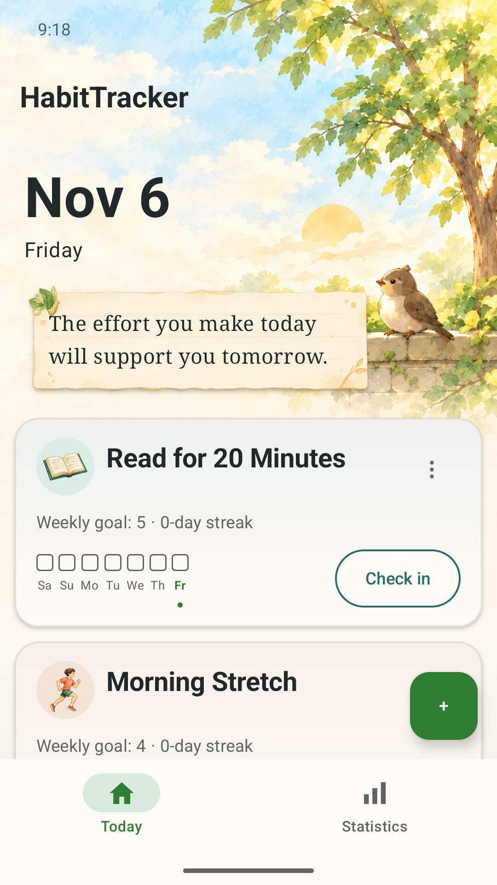
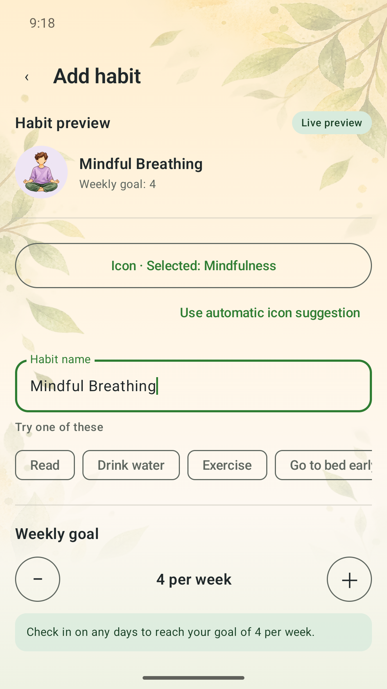
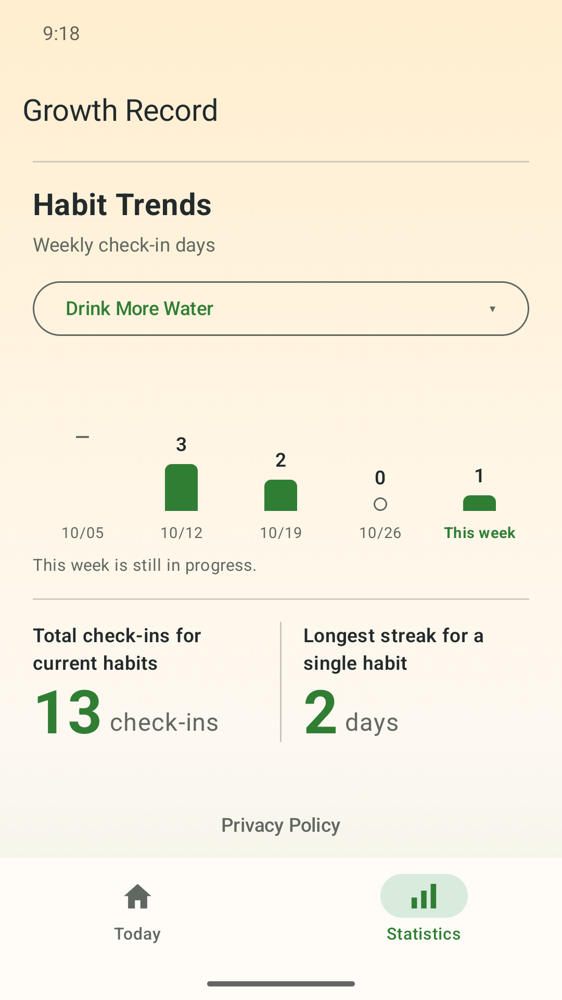
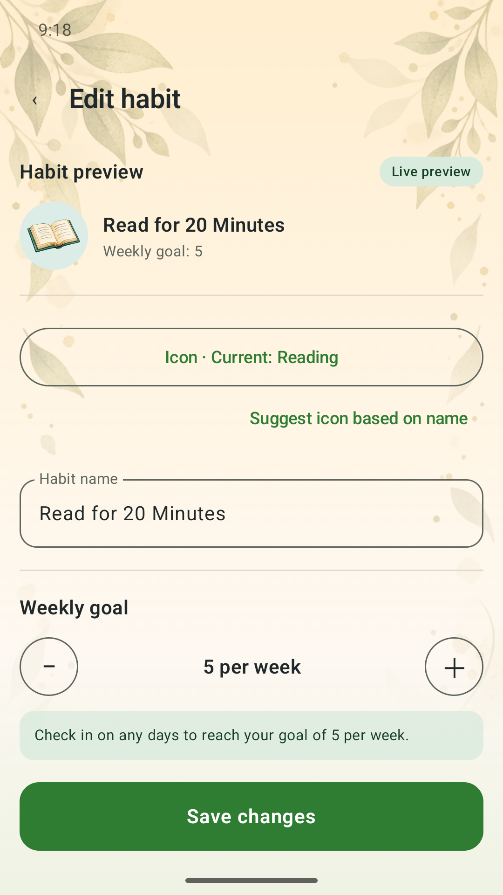

# HabitTracker · 习惯打卡

HabitTracker 是一款本地优先的 Android 习惯打卡应用：创建习惯并设定每周目标，记录每日行动，通过七日打卡足迹和五周趋势回看进展。项目使用 Kotlin、Jetpack Compose、ViewModel、Flow 和 Room 实现，无需账号或开发者服务器即可使用核心功能。

## 核心功能

- 创建、编辑和删除习惯，设置每周 1～7 次的目标；删除前确认，并从本机数据库一并删除该习惯的打卡记录。
- 根据名称中的中英文关键词建议图标，也可手动选择；新增和编辑表单展示当前图标。
- 在 Today 页面打卡或撤销当天打卡，查看最近七个自然日的记录与当前连续打卡天数。
- 在 Statistics 页面查看今日完成习惯数、最近七天每天的完成习惯数、现有习惯的累计打卡次数，以及现有习惯中最长的单项历史连续打卡天数。
- 选择习惯查看最近五个自然周的打卡天数；创建前的整周与创建后零打卡的周使用不同标记，创建当周只统计创建日起的日期，并提示本周仍在进行中。
- 界面语言与浅色、深色主题跟随系统设置；提供英语默认资源和简体中文文案，并为关键操作添加无障碍语义。

**工程重点**

- [今日打卡的临时状态](#今日打卡的临时状态)：点击后即时反馈，并协调同一习惯的连续操作。
- [自然日与统计口径](#自然日与统计口径)：以 epoch day 保存打卡日期，明确当前 streak 与五周趋势的计算边界。
- [数据库演进](#数据库演进)：通过每日唯一约束和显式 Room 迁移维护历史记录。

## 应用截图

<p align="center">
  
  
</p>
<p align="center">
  
  
</p>

图片来自 Android 模拟器上的真实应用界面，习惯及打卡数据仅用于展示。

## 技术栈

- Kotlin、Jetpack Compose、Material 3、Navigation Compose
- ViewModel、Lifecycle、Kotlin Coroutines、Flow / StateFlow / SharedFlow
- Room / SQLite、数据库迁移
- JUnit、Android 仪器测试、Compose UI 测试、Android Lint

## 架构与数据流

```text
Today UI      → DashboardViewModel → SetTodayHabitCheckedUseCase → HabitRepository → RecordDao
新增 / 编辑 UI → 对应 ViewModel      → HabitRepository                  → HabitDao
Statistics UI → StatsViewModel      ← HabitDao / RecordDao 的 Flow

HabitDao / RecordDao → Flow → DashboardViewModel / StatsViewModel
DAO 数据 + 本地日期 + 临时点击状态 → ViewModel 的 UiState → Compose UI
```

Compose 页面展示状态并上报操作。今日打卡使用专门的 UseCase；新增、编辑和删除通过 Repository 访问数据；统计 ViewModel 直接观察 DAO Flow。数据库、Repository、UseCase 与 ViewModel Factory 由 Application 级的 `AppContainer` 手动装配，项目保持单模块。

主要代码位于 `app/src/main/java/io/github/alight77/habittracker/`：`core/time/` 处理本地日期，`data/` 包含 Room 与 Repository，`domain/` 放置业务约束和打卡逻辑，`feature/` 组织各页面与 ViewModel，`ui/` 放置导航、共享组件和主题。

## 关键工程设计

### 今日打卡的临时状态

点击后，`DashboardViewModel` 立即更新页面中的临时目标状态。`SetTodayHabitCheckedUseCase` 协调同一习惯的操作；有写入正在执行时，同一天的待处理目标可以被后续点击覆盖，但执行中的数据库写入可能已经发生。写入失败或等待数据源确认超时后，ViewModel 会尝试读取持久化记录并调整临时显示；若读取失败，且该意图仍是当前意图，则移除对应的临时覆盖，必要时提示重试。

Room 对 `(habitId, date)` 建立唯一索引，同一习惯同一天最多保留一条记录；撤销打卡会把该记录更新为未完成状态。

### 自然日与统计口径

打卡日期保存为 epoch day，表示本地自然日而非某个固定时刻。本地自然日改变后，Today 与 Statistics 的相关状态会重新计算。当前连续打卡天数从**今天**向前数；若今天尚未打卡，该值为 0。历史最长连续天数先按现有每个习惯的完整完成记录计算，再取最大值。

七日统计的每个值是当天完成的不同习惯数。五周趋势按周一至周日的自然周统计**所选习惯的打卡天数**，本周只计算到今天；创建前的日期不计为漏打卡。图表展示打卡天数，不表示每周目标达成率。

### 数据库演进

当前 Room schema 为 v5，已注册的迁移路径包括：

- v2 → v3：将旧本地午夜毫秒日期转换为 epoch day，合并同一习惯同一天的重复记录。
- v3 → v4：为打卡记录增加指向习惯的外键与级联删除，并清理孤立记录。
- v4 → v5：为习惯增加图标字段，保留既有习惯和打卡记录。

## 测试与质量保障

仓库包含以下测试代码；这里描述的是覆盖范围，不代表本次 README 修改后重新执行了全套测试：

- JVM 单元测试：日期与 streak 计算、快速重复打卡及并发协调、统计汇总和五周趋势。
- Android 仪器测试：Room DAO 与迁移、主要页面交互及导航、Compose UI 的统计和表单展示。
- Android Lint：通过下方命令运行静态检查。

代表性测试：[快速重复打卡](app/src/test/java/io/github/alight77/habittracker/feature/dashboard/DashboardRapidToggleTest.kt)覆盖连续两次或三次点击时的目标状态切换；[五周趋势](app/src/test/java/io/github/alight77/habittracker/feature/stats/WeeklyCheckInTrendTest.kt)覆盖创建当周与创建前整周；[数据库迁移](app/src/androidTest/java/io/github/alight77/habittracker/data/local/HabitDatabaseMigrationTest.kt)覆盖旧日期转换与记录保留。

## 构建与运行

使用支持本项目 AGP 9.0.1 的 Android Studio，配置 JDK 17 与 Android SDK Platform 36。仓库已包含 Gradle 9.1.0 Wrapper；应用的 `minSdk` 为 24，可在 API 24 及以上的设备或模拟器运行。[AGP 9.0.1 官方兼容说明](https://developer.android.com/build/releases/agp-9-0-0-release-notes)列出了对应的 JDK 与 Gradle 要求。

在 Android Studio 打开项目并完成 Gradle Sync，选择设备后运行 `app`。也可在 Windows PowerShell 中执行：

```powershell
.\gradlew.bat :app:assembleDebug
.\gradlew.bat :app:testDebugUnitTest
.\gradlew.bat :app:lintDebug
```

连接 Android 设备或启动模拟器后，运行仪器测试：

```powershell
.\gradlew.bat :app:connectedDebugAndroidTest
```

## 数据隐私

习惯名称、每周目标、图标和打卡记录主要保存在设备上的应用私有 Room 数据库中。应用不提供账号或开发者运营的云同步，也没有向开发者服务器同步习惯记录的功能。Android 系统备份和设备迁移可能在满足设备及系统条件时包含该数据库。详见[隐私政策](https://alight77.github.io/android-habit-tracker/)。

## 版本与发布状态

当前**源码配置**为 `versionName 1.0`、`versionCode 2`，应用 ID 为 `io.github.alight77.habittracker`。Google Play 正式版仍在发布流程中；公开下载链接将在确认上架后补充。对应当前源码的 GitHub Release 将另行更新。
